<div align="center">


# Panjabi Business

### From your first shop to your next branch.
### বাংলাদেশের পাঞ্জাবি ব্যবসার জন্য একটি সংযুক্ত ব্যবসা ব্যবস্থাপনা অ্যাপ্লিকেশন।

A modular **Laravel + Filament** business workspace for Bangladeshi Panjabi retailers, online sellers, wholesalers, tailoring studios, and manufacturers.

**Sell online. Run your counter. Know your stock. Connect your branches.**


[Why Panjabi?](#why-panjabi-business) · [Screenshots](#see-the-application) · [Features](#explore-the-modules) · [Time savings](#how-much-time-could-your-business-save) · [Quick start](#run-it-locally) · [Demo users](#explore-with-demo-users) · [Roadmap](#what-is-next)

</div>

> **Build status:** a working business application with real database workflows and fictional demo businesses. Core commerce and operations are implemented. Payment, courier, attendance-device, and AI demonstrations are explicitly labeled simulators. Live merchant integrations and several advanced features remain on the roadmap. This README describes the current code; it does not present the original product specification as already complete.

## Why Panjabi Business?

A Panjabi business involves much more than a product list. One design becomes several sizes and colors. A sale may begin on a website and finish at a counter. A customer may need a fitting, a supplier may deliver in parts, and a second branch may need stock before an Eid rush.

Panjabi Business brings these daily activities into one workspace, so owners can spend less time copying information between notebooks, spreadsheets, messages, and separate systems.

| A familiar business problem | How the application helps |
| --- | --- |
| “Which branch has size 42 in this color?” | Variant stock records identify quantities by branch, SKU, size, and color. |
| “We sold this at the counter. Did the online stock change?” | POS and website orders use the same stock service. |
| “Where are today's pending orders?” | An order list and explicit fulfillment stages organize the work. |
| “The supplier delivered only part of our order.” | Partial purchase receipts update quantities and supplier dues. |
| “The stock left Dhaka but has not arrived in Chattogram.” | Dispatched transfers stay in transit until staff records receipt. |
| “What were this customer's measurements and deposit?” | Tailoring jobs keep measurements, work stages, payment collection, and delivery dates together. |
| “Did this callback or device event get processed twice?” | Reference checks and deduplication prevent repeated financial and attendance effects. |
| “I only need a few modules right now.” | Business presets and dependency checks let owners choose an appropriate configuration. |

### The opportunity for your business

**Give customers a place to discover you.** Publish a collection, individual product pages, size guidance, branch information, and campaign landing pages. A shareable catalog can support sales conversations from social channels without requiring customers to browse a spreadsheet.

**Sell through more than one channel.** Run an online COD checkout and a physical POS against the same catalog. Use wholesale variant prices when appropriate. Record verified cash, bank, or mobile transfers without pretending that manual entry is an online gateway charge.

**Expand with more visibility.** Keep separate branch quantities, staff assignments, transfers, and operational records while maintaining an owner-level view of the business.

**Support more ways of working.** Add a tailoring service, track a simple production batch, or organize suppliers and employee payments as your business needs change. Advanced variants of these workflows are listed in the roadmap.

**Build a foundation you can extend.** The source code, domain services, migrations, tests, and Filament resources live in this repository. Developers can build further integrations around explicit business workflows.

## See the application

These are **real captures of the running application**, using fictional demo data. Product illustrations are original demo assets; the catalog also supports uploaded product photographs.

### Your business, at a glance

Orders, pending work, accessible stock, and branch information in one overview.

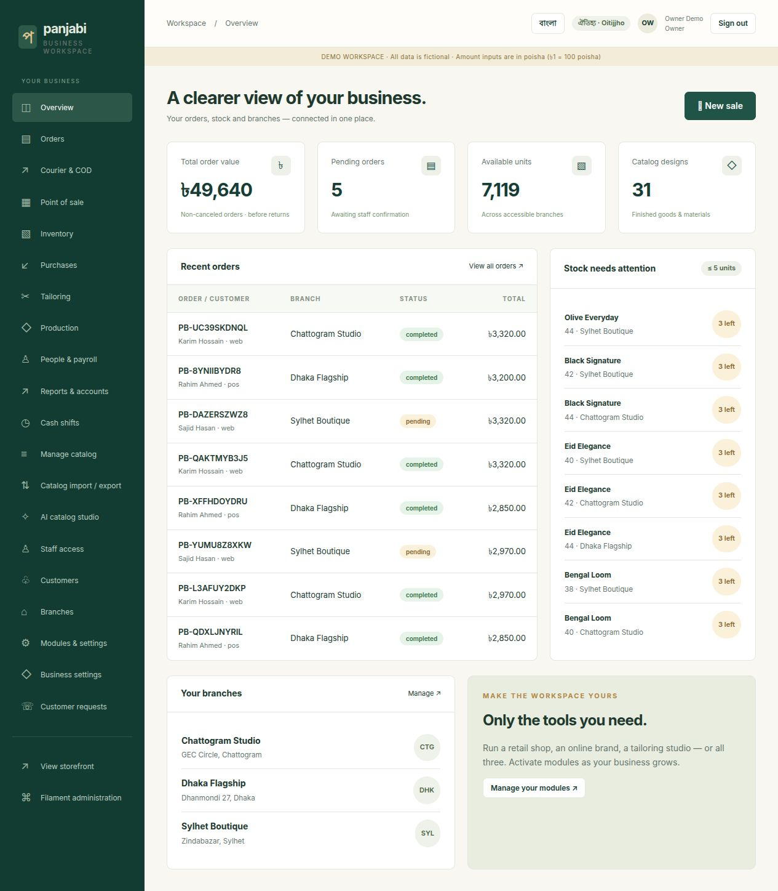

### A storefront customers can explore

A collection page with search, category filtering, size/color variants, product details, a shopping bag, and checkout.

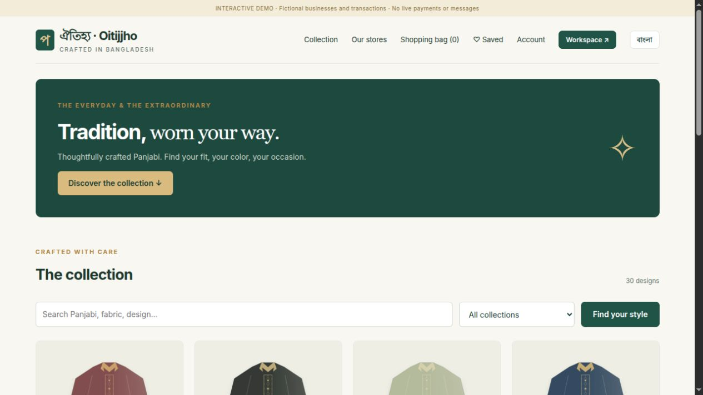

<table>
<tr>
<td width="50%"><strong>A focused point of sale</strong><br>Search or scan, choose quantities, and record split payments.<br><br>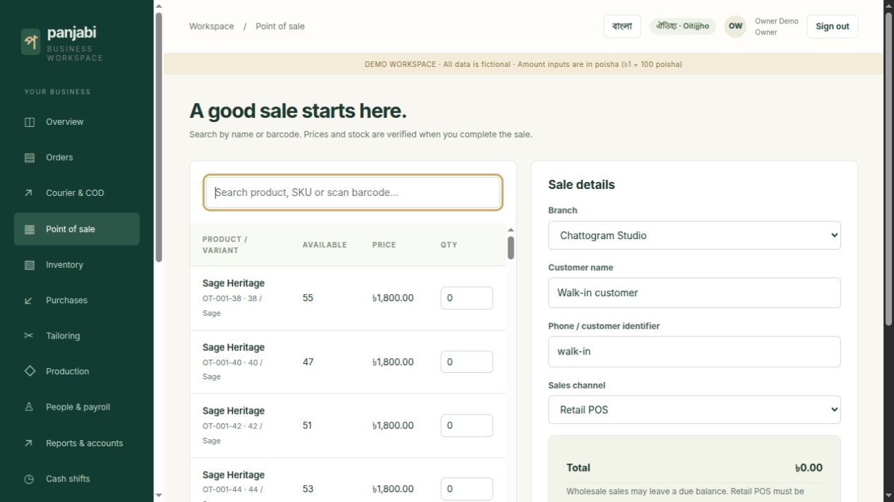</td>
<td width="50%"><strong>Stock across your branches</strong><br>See available units and maintain an auditable movement history.<br><br>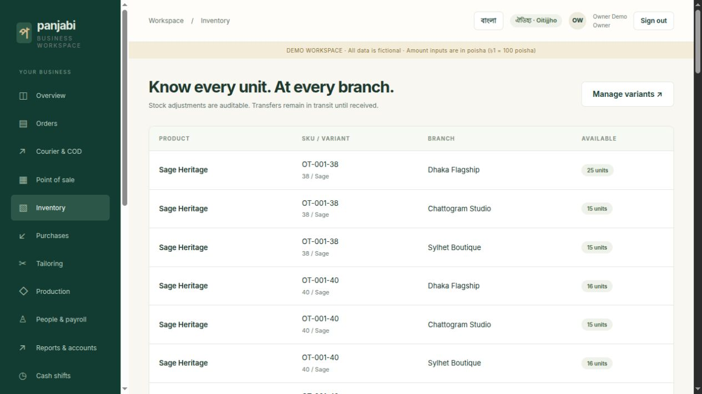</td>
</tr>
<tr>
<td width="50%"><strong>Orders with a clear next step</strong><br>Review fulfillment and payment status separately.<br><br>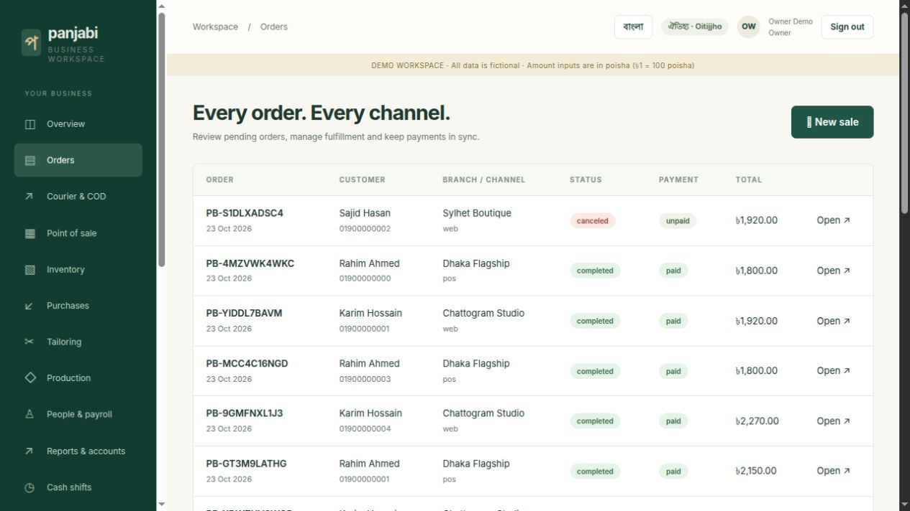</td>
<td width="50%"><strong>Tools that fit your operation</strong><br>Choose modules with server-enforced dependencies.<br><br>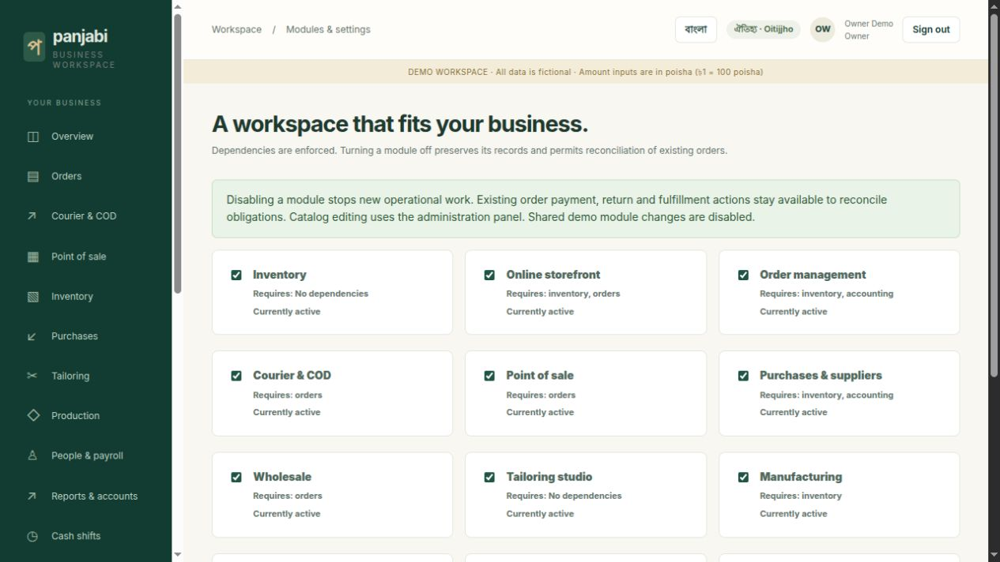</td>
</tr>
</table>

<details>
<summary><strong>More screenshots: public website, tailoring, accounting, Filament, and Bengali invoice</strong></summary>

### Public business-solution website

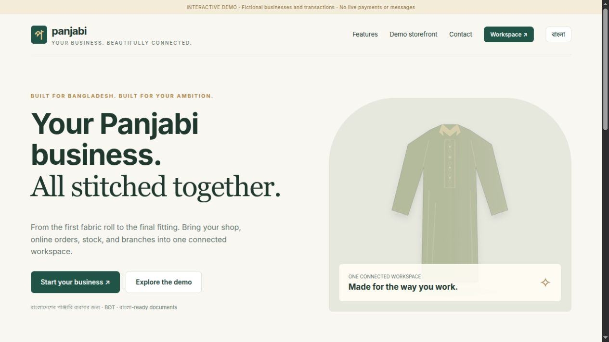

### Tailoring studio

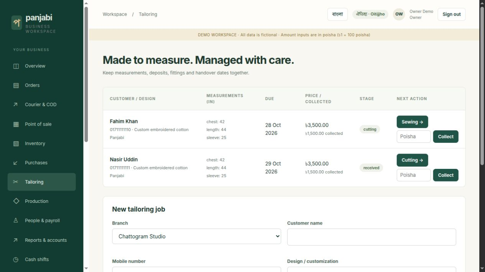

### Accounting and reporting

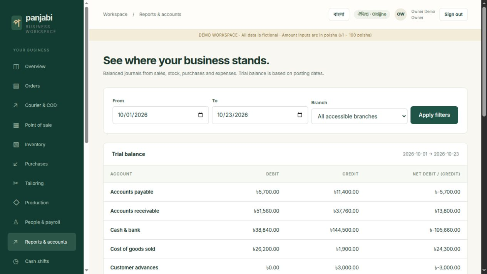

### Filament catalog administration

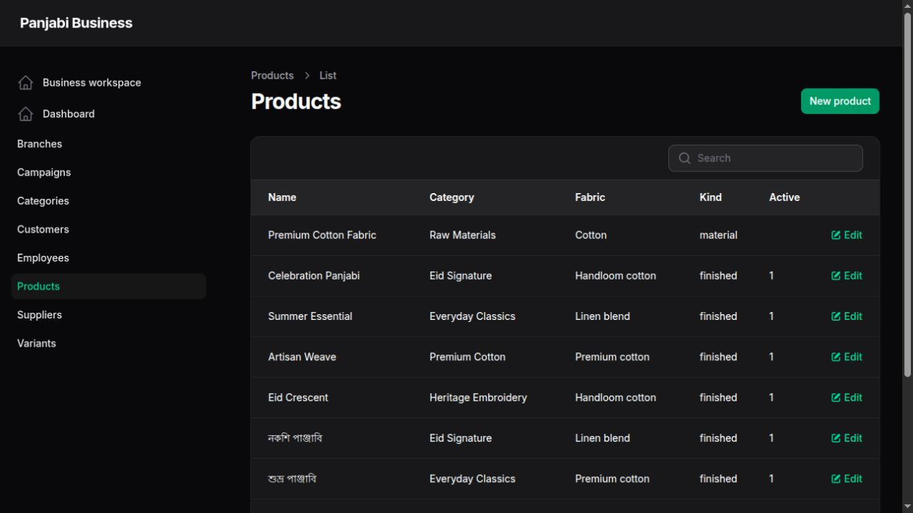

### Bengali and English invoice

The image below is rendered from an actual PDF generated through `laravel-unicode-pdf`, using bundled fonts.


</details>

## Who can use it?

| Business type | A practical starting point | What you can add as you grow |
| --- | --- | --- |
| Single retail shop | Catalog, stock, POS, receipts, customer records | Purchasing, additional staff, branch operations |
| Online or social-commerce seller | Public storefront, shareable products, COD checkout, pending orders | Campaign pages, fulfillment processes, live integrations when implemented |
| Multi-branch retailer | Branch stock, assigned cashiers/managers, transfers | Consolidated financial visibility and further branch workflows |
| Wholesaler | Wholesale variant pricing, customer records, payments and dues | Dealer credit limits, quotation pipelines, and dispatch scheduling on the roadmap |
| Tailoring studio | Measurements, deposits, fittings, progress, handover | More measurement fields, alteration history, and fabric management extensions |
| Small manufacturer | Raw-material variants and simple production batches | Multi-stage work in progress, subcontracting, BOMs, and costing extensions |
| Developer or implementation partner | Laravel services, Filament resources, reproducible demo, tests | Custom integrations, industry workflows, and deployment services |

The application supports **multiple independent businesses**. Each business has its own organization context, branches, products, customers, and transactions. The current user model assigns each user to one business and one primary role; cross-business memberships are a future extension.

## Explore the modules

**Status guide:** **Working** = implemented application workflow; **Basic** = usable with the stated scope; **Simulation** = functional local demonstration without real external side effects; **Planned** = not implemented yet.

### 1. Public website, storefront, and customer experience — Working

- Public landing page, feature overview, contact entry points, and demo access page.
- Separate storefront for each business using a tenant path.
- Published product collection, search, category filters, and pagination.
- Product details with fabric, fit, size/color choices, prices, and stock information.
- Product photographs or bundled Panjabi illustrations.
- Shopping bag, quantity selection, removal, and server-verified totals.
- Guest COD checkout with Bangladesh mobile-number validation.
- Configurable business delivery fee; shipping is displayed before checkout.
- Private, unguessable order-tracking links with masked phone numbers.
- Customer signup, sign-in, order history, and change-request submission.
- Session-based wishlist for saving products in the current browser.
- Branch contact pages, size guide, and business delivery/return policies.
- Scheduled campaign landing pages with optional category selection.
- Common Bengali/English interface labels and a language switch; Bengali names and content are supported. Full translation coverage is still being expanded.

**Business value:** a discoverable catalog, a consistent order-entry path, and fewer repeated product-detail conversations. Facebook/WhatsApp API automation, custom-domain routing, and advanced SEO feeds are not implemented.

### 2. Catalog and product variants — Working

- Categories and products with unique business-scoped slugs.
- Fabric, fit, descriptions, featured flags, publication status, and media.
- Finished goods and raw-material product types.
- Size/color variants with SKU, optional barcode, retail price, wholesale price, standard cost, and reorder field.
- Filament create/edit screens with tenant-scoped records.
- CSV template, preview, row validation, duplicate-SKU detection, and transactional import.
- Imports create unpublished products for review and do not manufacture opening stock.
- Catalog CSV export with spreadsheet-formula escaping.
- Product-photo upload accepts JPEG, PNG, and WebP files.
- Unicode slug generation through `laravel-universal-slug`.

**Current scope:** CSV imports support up to 500 rows / 1 MB per upload. Bundle composition, configurable attribute schemas, barcode-label sheets, and slug-change redirects are planned.

### 3. Orders, fulfillment, payments, and returns — Working

- Web, retail POS, and wholesale order channels.
- Pending-order review, customer/address snapshots, and immutable item price/cost snapshots.
- Separate order, payment, and fulfillment fields.
- Validated fulfillment progression: pending → confirmed → processing → packed → shipped → delivered → completed.
- Restricted cancellation with stock and financial reversal.
- Verified manual cash, bank, mobile-transfer, and COD payment recording.
- Split payments, partial balances, unique payment references, and overpayment protection.
- Checkout idempotency and duplicate-payment protection.
- Partial returns from delivered/completed orders, with quantity limits.
- Sellable returns restore inventory; damaged returns post to a damage account.
- Refund/balance adjustments and cost reversal use the original sale snapshots.
- Printable invoices and downloadable Unicode PDFs.
- Customer cancellation/return requests for staff review.

**Current scope:** cash refunds are recorded in the ledger; the application does not send real money. Shipping fees are retained during item returns. Formal exchange linking, order amendments, partial fulfillment, preorders, and backorders are planned.

### 4. Point of sale and cash shifts — Working

- A focused POS with keyboard search by product, SKU, or barcode.
- Scanner-style Enter behavior when one matching variant is visible.
- Server-authoritative stock and price verification.
- Retail or wholesale variant pricing.
- Exact-cash helper and split cash/bank collection.
- Full-payment validation for ordinary retail POS sales.
- Cashier shift opening, closure, expected cash, counted cash, and discrepancy display.
- Cash payments/refunds can be associated with the current open shift.
- Branch-assigned cashiers must open a shift before selling.
- Order, stock, payment, and journal updates are transactional.

**Current scope:** POS needs connectivity. Offline synchronization, held carts, cash-in/out approvals, dedicated thermal layouts, and printer/drawer hardware control are planned. Browser printing can be used with compatible printers.

### 5. Inventory and multi-branch transfers — Working

- Variant quantities by branch and an append-only operational movement history.
- Opening-stock and positive/negative adjustments with a required reason.
- Conditional stock updates that reject insufficient quantities.
- Order cancellation and return stock effects.
- Owner/admin transfer dispatch and partial destination receipt.
- In-transit quantities remain separate from destination availability.
- Low-stock attention cards and recent movement visibility.
- Business and branch restrictions on operational records.

**Valuation:** this build uses **locked standard variant cost**, with purchase/production differences posted to variance accounts. It does not implement moving weighted average or FIFO. Standard cost is locked after stock movements until a revaluation workflow is added.

**Current scope:** whole base units; dedicated warehouse/bin hierarchies, fractional fabric quantities, stocktake sessions, reservation expiry, and transfer discrepancy closure are planned.

### 6. Purchasing and suppliers — Basic

- Supplier records and purchase orders.
- Ordered versus received quantities.
- Multiple partial receipts against an order.
- Inventory and accounts-payable posting on receipt.
- Partial supplier payments and remaining purchase balances.
- Standard-cost purchase variance when actual purchase cost differs.

**Current scope:** one variant per purchase-order record. Multi-line purchasing documents, landed costs, purchase returns, and dedicated supplier statements are planned.

### 7. Wholesale — Basic

- Variant-level wholesale prices.
- Wholesale sales entered through the POS workflow.
- Partial payment and outstanding order balances.
- Shared inventory and accounting rules.

**Current scope:** no enforced dealer credit limits, quantity-break pricing, dealer portal, or quotation pipeline yet. Staff must apply their own credit-approval process.

### 8. Tailoring studio — Basic

- Customer name, phone, design notes, and promised delivery date.
- Chest, garment length, and sleeve measurements in inches.
- Price, deposit, collected amount, and remaining balance.
- Received → cutting → sewing → fitting → ready → delivered stages.
- Full-collection requirement before final handover.
- Customer-advance and handover-revenue postings.

**Business value:** fewer lost measurement notes, clearer delivery commitments, and visible collection status. Reusable measurement profiles, alteration/rework, worker assignments, and customer-supplied fabric ledgers are planned.

### 9. Production — Basic

- Raw-material and finished-goods variants.
- Planned batches with output quantity, material quantity, and paid labor cost.
- Transactional material consumption and finished-stock receipt on completion.
- Duplicate completion protection.
- Production variance against standard finished-goods cost.

**Current scope:** one material variant and one output variant per batch. Multi-material BOMs, cutting plans, work-in-progress stages, wastage allocation, quality checks, and subcontracting are planned.

### 10. Accounting, expenses, and reports — Basic

- Balanced double-entry journal services.
- Sales, delivery revenue, receivables, payments, inventory, and cost-of-goods postings.
- Cancellation, return, damage, supplier, payroll, tailoring, and production entries.
- Cash/bank, COD clearing, remittance fees, and operating expenses.
- Date- and branch-filtered trial balance.
- Purchase and production variance accounts.
- No UI for deleting posted journal entries.

**Current scope:** operational invoices post when the order is accepted; cancellation reverses them. This is not a complete statutory accounting suite. Configurable chart of accounts, fiscal locks, VAT/tax rules, bank reconciliation, formal financial statements, and accountant sign-off remain to be implemented.

### 11. People, payroll, and attendance — Basic + Simulation

- Employees, positions, branch assignments, joining dates, and fixed monthly salaries.
- Manual attendance events with unique external event identifiers.
- Monthly salary payment less an explicitly entered deduction.
- Duplicate employee/month payroll protection.
- Attendance Hub-backed device simulation, normalized to business attendance records.
- Repeated same-day simulated device events do not create duplicates.
- No biometric images or fingerprint templates are used in the demonstration.

**Current scope:** actual attendance-machine connectivity is not configured. Device support depends on the package driver and hardware/protocol. Leave, overtime, overnight-shift calculation, payroll approval, payslip workflows, and device mapping UI are planned.

### 12. Courier and COD reconciliation — Simulation

- Book a local simulated shipment for a packed order.
- Progress the order to shipped and simulate successful delivery.
- Record simulated COD collection in a clearing account.
- Reconcile remittance net of a recorded courier fee.
- Prevent duplicate booking, delivery collection, and remittance effects.

**No real courier is contacted.** Pathao, Steadfast, RedX, delivery labels, live tracking webhooks, and return-to-origin integration need provider-specific implementation and merchant credentials.

### 13. Online payment verification — Simulation

- Local demo payment attempts with unique references.
- Success and failure scenarios from the private tracking page.
- HMAC-signed server-side callback verification.
- Amount validation and idempotent callback processing.
- Rejected signatures do not post payments.

**No real customer is charged.** bKash, Nagad, SSLCommerz, and real refund APIs are not implemented. A browser redirect is not treated as proof of a live payment.

### 14. AI catalog studio — Simulation / Configurable

- Application-owned catalog draft/review screens.
- `laravel-ai-catalog` generation powered by `laravel-ai-hub`.
- Demo mode uses the Hub fake provider and never contacts a live AI service.
- Keyword or authorized HTTPS reference input, English/Bengali locale choice.
- Live AI requires explicit enablement and operator provider configuration.
- Public-URL reader with protocol, port, DNS/IP, redirect, response-size, and timeout checks.
- Source text is treated as untrusted; generated fields are sanitized and reviewed.
- Approval creates an unpublished product; staff must add variants and publish separately.
- AI cannot post stock, payments, refunds, or accounting entries.
- Per-business generation rate limit and draft provenance.

**Current scope:** operator-level provider configuration; no per-tenant key management or complete cost-budget UI. Live-provider behavior and hostile-network scenarios need additional integration testing before production use.

### 15. Administration, access, and business configuration — Working

- Business registration with retail, online, wholesale, manufacturing, and tailoring presets.
- Multiple organizations and multiple branches per business.
- Server-side organization scopes and branch-restricted operational queries.
- Business owner, administrator, manager, cashier, inventory, accountant, production, HR, customer, and platform roles.
- Owner-managed staff creation outside shared demo mode.
- Module dependencies, activation checks, and data-preserving deactivation.
- Historical access and reconciliation of existing obligations after deactivation.
- Business identity, contact details, delivery fee, and policy settings.
- Platform overview and business suspension/restoration outside shared demo mode.
- Audit records for selected business actions.
- Filament password reset flow; production email delivery must be configured.
- Separate protected package dashboard at `/tools/admin-panel` with actual tenant metrics.

**Current scope:** one primary role and optional branch assignment per user. Fine-grained editable permissions, complete audit coverage, two-factor authentication, email verification enforcement, subscriptions, and cross-business memberships are planned.

## Choose your modules. Keep your history.

You do not need to run every workflow on day one.

| Start as… | Preset emphasis |
| --- | --- |
| Retail shop | POS, orders, inventory, purchasing, accounting, customers |
| Online seller | Storefront, orders, inventory, accounting, customers |
| Wholesaler | Wholesale, orders, inventory, purchasing, accounting, customers |
| Manufacturer | Full module selection for exploring connected operations |
| Tailoring studio | Tailoring, accounting, customers |

Modules declare dependencies. For example, POS requires order management; order management requires inventory and accounting. Invalid configurations are rejected on the server.

Disabling a module keeps historical records. New work is blocked through the applicable operational entry points, while existing payment/fulfillment obligations can still be reconciled. Shared demo module/settings changes are protected so visitors cannot dismantle the sample workspace.

See [module dependencies and behavior](docs/MODULES.md).

## How much time could your business save?

The biggest opportunity is **reducing repeated entry and repeated checking**. Enter an order once; reuse the information for its stock movement, payment record, invoice, and operational journal. Retrieve a measurement or supplier receipt instead of searching paper records.

### An illustrative daily example

These are **planning assumptions, not measured product benchmarks or promised results**. They assume trained staff, accurate master data, working connectivity, and a process that avoids duplicate work. Measure your own before/after times.

| Activity | Assumed manual approach | Assumed application workflow | Illustrative saving |
| --- | --- | --- | --- |
| Enter/reconcile 40 orders | 5 minutes × 40 | 3 minutes × 40 | 80 minutes/day |
| Look up stock across branches | 35 minutes total | 15 minutes total | 20 minutes/day |
| Prepare basic day-end cash comparison | 35 minutes | 15 minutes | 20 minutes/day |
| Record that day's supplier receipt/payment work | 25 minutes | 15 minutes | 10 minutes/day |
| **Combined example** | **295 minutes** | **165 minutes** | **130 minutes/day** |

**130 minutes/day = 2 hours 10 minutes/day. Across 26 working days, that is approximately 56 hours 20 minutes of staff capacity per month.**

This arithmetic assumes the activities are distinct; do not count the same reconciliation work twice. It does not mean payroll costs automatically fall, revenue increases, or every shop will achieve this result.

```text
Monthly capacity recovered (hours)
  = Σ [(manual minutes − application minutes) × activity frequency]
    × working days ÷ 60
```

| If your order volume is… | Order-entry saving at the assumed 2 minutes/order | With the same assumed 50-minute daily support-work saving |
| --- | --- | --- |
| 10 orders/day | 20 minutes/day | 1 hour 10 minutes/day |
| 40 orders/day | 80 minutes/day | 2 hours 10 minutes/day |
| 100 orders/day | 200 minutes/day | 4 hours 10 minutes/day |

### Where the recovered capacity can go

- Respond to customers and confirm pending orders sooner.
- Prepare a collection or campaign page before a seasonal launch.
- Investigate stock discrepancies while they are still small.
- Improve product photographs, descriptions, and size guidance.
- Spend more time on fittings, quality checks, supplier conversations, and staff training.
- Review due payments and branch performance more consistently.

**Validate the opportunity:** time ten representative tasks before rollout, repeat after staff onboarding, account for checking/corrections, then compare like-for-like results.

## Connected workflows

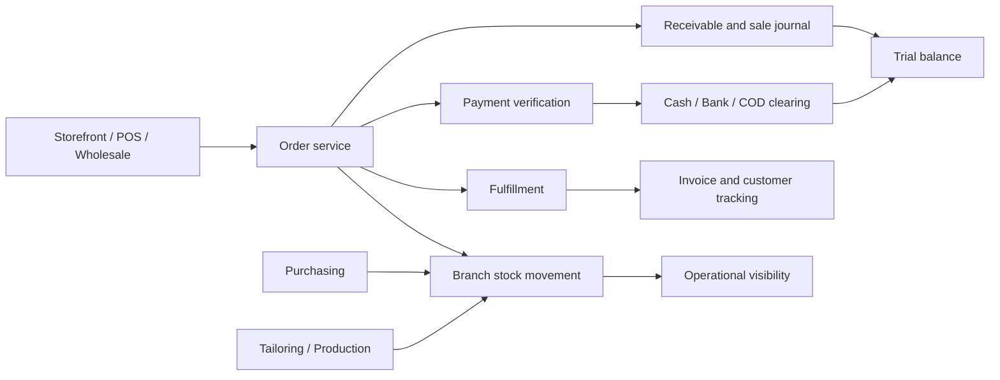

### Example journeys you can try

1. **Online order → delivered sale:** browse the demo store, choose a variant, check out with COD, retain the tracking link, confirm/pack the order as staff, then use manual fulfillment or the courier simulator.
2. **Counter sale → closed shift:** sign in as a cashier, open a shift, scan/search a variant, enter the quantity, split payment, complete the sale, inspect its invoice, and close with counted cash.
3. **Supplier delivery → supplier payment:** create a purchase order, receive part of the quantity, inspect stock/payables, and record a partial supplier payment.
4. **Dhaka → Chattogram stock:** dispatch a transfer, see units in transit, receive a partial quantity, and compare the branch balances.
5. **Custom Panjabi → handover:** create measurements and a deposit, progress through tailoring stages, collect the balance, and deliver the finished job.
6. **Raw fabric → finished units:** plan a simple batch, consume material on completion, receive finished variants, and inspect the variance journal.
7. **AI idea → unpublished listing:** generate a simulated draft, correct its facts, approve it, add variants, then choose whether to publish.

## Built with the requested Laravel packages

| Package | Role in this application | Current integration status |
| --- | --- | --- |
| [imrandevbd/drutogoti](https://packagist.org/packages/imrandevbd/drutogoti) | Performance profiling/diagnostics toolkit | Installed and pinned; runtime watchers/dashboard disabled by default. It is not an automatic speed guarantee. |
| [imrandevbd/laravel-admin-panel](https://packagist.org/packages/imrandevbd/laravel-admin-panel) | Additional protected package dashboard | Integrated at a separate owner-only path; real scoped metrics replace sample data. Filament remains the primary administrator. |
| [imrandevbd/laravel-ai-catalog](https://packagist.org/packages/imrandevbd/laravel-ai-catalog) | Catalog generation pipeline | Integrated behind application review screens; package public studio/API disabled. |
| [imrandevbd/laravel-ai-hub](https://packagist.org/packages/imrandevbd/laravel-ai-hub) | AI provider abstraction and fake testing provider | Demo simulation working; live operation requires explicit setup. |
| [imrandevbd/laravel-attendance-hub](https://packagist.org/packages/imrandevbd/laravel-attendance-hub) | Device protocol abstraction | Package-backed simulation working; real hardware unverified. |
| [imrandevbd/laravel-unicode-pdf](https://packagist.org/packages/imrandevbd/laravel-unicode-pdf) | Multilingual invoices | Integrated, rendered, and visually checked with bundled fonts. |
| [imrandevbd/laravel-universal-slug](https://packagist.org/packages/imrandevbd/laravel-universal-slug) | Multilingual product slugs | Integrated into catalog seeding and AI draft approval. |

Laravel 12 was selected because several requested package releases currently declare Laravel support through version 12. Six requested packages are pinned development revisions in `composer.lock`; AI Hub uses a stable release. Review upgrades deliberately. See [package details](docs/PACKAGES.md).

## Run it locally

### Requirements

- PHP **8.3+** with Composer 2; tested here on PHP 8.5.
- Required extensions for the installed stack include `mbstring`, `intl`, `bcmath`, `curl`, `dom`, `fileinfo`, `zip`, and an appropriate PDO database driver. Run `composer check-platform-reqs` for the definitive lockfile requirements.
- SQLite for the quickest local demo; PostgreSQL is also tested. MySQL has not yet been verified by this project's suite.
- Node.js compatible with Vite 8; Node **22.12+** is a practical choice for the frontend build.
- Internet access for the initial Composer/npm installation. Core demo workflows work without live external services afterward.

### Fresh checkout

```bash
composer install
cp .env.example .env
php artisan key:generate
```

Set `DEMO_MODE=true` in `.env` if you want fictional sample businesses and demo logins. Keep `APP_ENV=local`. For SQLite, ensure `database/database.sqlite` exists; a fresh file can be created with:

```bash
php -r "file_exists('database/database.sqlite') || touch('database/database.sqlite');"
php artisan migrate
php artisan storage:link
npm ci
npm run build
```

Seed the optional demo, then start the application:

```bash
php artisan business:demo
php artisan serve --host=127.0.0.1 --port=8030
```

Set `APP_URL=http://127.0.0.1:8030` to match this example. If you use another port, update the URL accordingly.

| Start here | Local address |
| --- | --- |
| Public website | [http://127.0.0.1:8030](http://127.0.0.1:8030) |
| Role-based demo access | [http://127.0.0.1:8030/demo](http://127.0.0.1:8030/demo) |
| Fictional Oitijjho storefront | [http://127.0.0.1:8030/shop/aarong-demo](http://127.0.0.1:8030/shop/aarong-demo) |
| Independent seller storefront | [http://127.0.0.1:8030/shop/noor-demo](http://127.0.0.1:8030/shop/noor-demo) |
| Business workspace | [http://127.0.0.1:8030/business](http://127.0.0.1:8030/business) |
| Filament administration | [http://127.0.0.1:8030/admin](http://127.0.0.1:8030/admin) |
| Platform overview | [http://127.0.0.1:8030/platform](http://127.0.0.1:8030/platform) |

These are **local development URLs**, not a publicly hosted service. `aarong-demo` is a legacy internal seed slug for the fictional Oitijjho store; this project is not affiliated with Aarong or any other retailer.

### Start with your own empty business

Keep `DEMO_MODE=false`, migrate the database, and open `/register`. Choose your business type, create the workspace, add branches and products, then post opening stock before attempting a sale.

No sample users or fictional transactions are needed for a clean onboarding flow. The shared-demo seed command refuses to run in production or when demo mode is off.

## Explore with demo users

All accounts below are fictional and created only by the guarded demo seeder.

**Demo password: `DemoOnly!2026`**

| Role | Email | Intended scope |
| --- | --- | --- |
| Platform administrator | `platform@panjabi.demo` | Business overview; no tenant impersonation |
| Business owner | `owner@panjabi.demo` | Full Oitijjho business workspace |
| Branch manager | `manager@panjabi.demo` | Dhaka branch operations |
| Cashier | `cashier@panjabi.demo` | Dhaka POS, orders, and cash shifts |
| Inventory manager | `inventory@panjabi.demo` | Catalog, inventory, and purchasing |
| Accountant | `accountant@panjabi.demo` | Accounting and reports |
| Production supervisor | `production@panjabi.demo` | Production and tailoring |
| HR officer | `hr@panjabi.demo` | Employees, payroll, and attendance |
| Customer | `customer@panjabi.demo` | Own customer order history |
| Independent seller | `seller@panjabi.demo` | Separate Noor Online business |

The sample data includes two businesses, three Oitijjho branches plus one independent seller location, 30 Oitijjho finished-product designs with 120 variants, raw fabric, another seller catalog, orders, payments, supplier records, partial receipts, an in-transit transfer, tailoring jobs, production batches, employees, attendance, payroll, and expenses.

Re-running `business:demo` does not duplicate the seeded businesses. Demo mode protects selected settings and access changes; it is **not** a disposable public sandbox reset service. Do not expose a shared demo containing real business data.

## Verification and data integrity

The recorded suite currently passes **29 tests and 139 assertions on SQLite**. **PostgreSQL 16 also passes 29 tests and 139 assertions.** Details are recorded in [verification notes](docs/VERIFICATION.md) and [the test result file](docs/test-results-postgresql.json).

```bash
php artisan test
vendor/bin/pint --test
npm run build
composer check-platform-reqs
```

Coverage includes order/payment/return flows, oversell rollback, cancellation reversal, partial purchase receipts, supplier payments, stock transfers, module dependencies, tampered tenant/branch access, foreign-key isolation, tailoring handover, production/payroll deduplication, customer checkout/tracking, page rendering, AI draft review, PDF generation, CSV validation, unsafe URL rejection, courier reconciliation, attendance simulation, POS payment validation, cash shifts, gateway signature checks, failed payment attempts, and the language switch.

Important implementation choices:

- Money is stored in integer **poisha**: ৳1 = 100 poisha. Many operational forms currently accept poisha directly.
- Server-side calculations determine authoritative prices, stock changes, and balances.
- Financial and stock services use database transactions and explicit reference checks.
- Inventory writes include an atomic quantity condition to reject unavailable stock.
- Tenant and branch scope tests cover ordinary application access; a full independent security audit has not been performed.
- Posting balance checks prevent unbalanced journal entries.
- PostgreSQL test-suite verification is not the same as a load test or a complete concurrent-checkout stress test.
- There are no claims of verified live merchant settlement, real courier dispatch, or physical-device compatibility.

## What is next?

The original [product specification](docs/PRODUCT_SPECIFICATION.md) is intentionally broader than the current implementation. The [implementation status](docs/IMPLEMENTATION_STATUS.md) tracks the gap.

| Area | Planned opportunities |
| --- | --- |
| Live commerce integrations | bKash, Nagad, SSLCommerz, real refunds, Pathao/Steadfast/RedX adapters, signed provider webhooks |
| Inventory depth | Warehouses/bins, stocktakes, fractional units, reservations/expiry, FIFO or weighted-average valuation, revaluation |
| Merchandising | Bundles, size-chart management, richer configurable attributes, coupons, scheduled price rules, barcode-label sheets |
| Advanced orders | Amendments, partial shipments, preorders, linked exchanges, formal return authorization and RTO workflows |
| Wholesale | Quotations, dealer accounts, credit limits, quantity tiers, statements, dispatch plans |
| Manufacturing | BOMs, multi-stage WIP, QC, wastage, subcontracting, multi-output costing |
| Tailoring | Reusable measurement profiles, customer fabric, alterations, assignments, richer measurements |
| CRM and retention | Loyalty points, store credit, vouchers, referral campaigns, consent-aware messaging, segmentation |
| People operations | Real device mappings, leave, shift rules, overtime, payroll approval, payslips |
| Financial operations | Chart-of-account management, fiscal periods, tax/VAT rules, full financial statements, bank reconciliation |
| Platform | Multi-business memberships, subscription plans/entitlements, custom domains, stronger audit and access controls |
| Experience | Full Bengali translation coverage, broader accessibility testing, notification delivery, richer exports, dedicated thermal receipts |
| Reliability | Concurrent-checkout stress tests, browser automation suite, load testing, backup/restore drills, production deployment validation |

These are extension opportunities, **not enabled features hidden behind configuration**. Turning on a module cannot activate code that has not been implemented.

## Documentation and project layout

| Guide | What it explains |
| --- | --- |
| [Architecture](docs/ARCHITECTURE.md) | Business boundaries, models, services, isolation, and accounting choices |
| [Modules](docs/MODULES.md) | Dependencies, presets, and deactivation behavior |
| [Demo](docs/DEMO.md) | Accounts, sample data, and walkthroughs |
| [Workflows](docs/WORKFLOWS.md) | States, stock effects, and posting rules |
| [Packages](docs/PACKAGES.md) | Versions, compatibility, and requested-package integration |
| [Integrations](docs/INTEGRATIONS.md) | Simulators, configuration, disabled package routes, and live-service gaps |
| [Deployment](docs/DEPLOYMENT.md) | Environment, processes, storage, and production preparation |
| [Verification](docs/VERIFICATION.md) | Actual checks, results, and limits |
| [Implementation status](docs/IMPLEMENTATION_STATUS.md) | Current scope and outstanding specification work |
| [Screenshots](docs/images/README.md) | Capture provenance and image inventory |
| [Full original scope](docs/PRODUCT_SPECIFICATION.md) | The broader end-to-end product requirements |

```text
app/
  Filament/Resources/       Catalog, variants, branches, customers, suppliers, staff, campaigns
  Http/Controllers/        Public, storefront, operations, integrations, settings, platform
  Http/Middleware/         Business access, owner access, store context, locale
  Models/                  Organization-scoped business records
  Services/                Orders, stock, ledger, operations, CSV, AI, courier, demo gateway
config/                    Module registry and secured package configuration
database/                 Migrations, factories, guarded demo seeders
lang/                      Bengali interface strings
public/                    Application styling, POS script, original SVG assets, sample CSV
resources/                 Blade views and bundled PDF fonts
routes/                    Public, business, and integration routes
tests/                     Feature and service integration tests
docs/                      Specification, technical guides, verification, screenshots
```

### Contributing and implementation ideas

Report a reproducible bug, propose a workflow with a clear business example, or contribute a tested vertical slice. Financial and inventory changes should include a reconciliation scenario, and new endpoints should include tenant/branch authorization checks. Keep screenshots and feature claims aligned with the code.

If you find the project useful, star the repository, share it with a shop owner or Laravel developer, and help improve the workflows that matter most to Bangladeshi businesses.

---

## 🤝 Let's Connect & Collaborate

I am open to **Senior Remote Full-Stack Roles**, **AI Platform Architecture Contracts**, and **Enterprise Technical Advisory**.

**Timezone:** UTC+6 (Dhaka / Rangpur, Bangladesh) — Flexible overlap with US, UK, and European business hours.

**Delivery Mode:** Async-ready, Slack, Discord, Jira, GitHub, and production-first accountability.

| Channel | Address / Handle | Quick Action |
| --- | --- | --- |
| 🌐 Primary Portfolio | [imrandev.bd](https://imrandev.bd) | [Visit Site ↗](https://imrandev.bd) |
| 📦 Packagist Packages | [packagist.org/packages/imrandevbd/](https://packagist.org/packages/imrandevbd/) | [View Packages ↗](https://packagist.org/packages/imrandevbd/) |
| 💼 LinkedIn Profile | [linkedin.com/in/imranbru99](https://linkedin.com/in/imranbru99) | [Connect ↗](https://linkedin.com/in/imranbru99) |
| 🐙 GitHub Profile | [github.com/imranbru99](https://github.com/imranbru99) | [Follow ↗](https://github.com/imranbru99) |
| 💬 WhatsApp Direct | +880 1576-918420 | [Chat Now ↗](https://wa.me/8801576918420) |
| 📧 Direct Email | [me@imrandev.bd](mailto:me@imrandev.bd) | [Send Email ↗](mailto:me@imrandev.bd) |
| 🐦 X (Twitter) | [@imrandev_bd](https://x.com/imrandev_bd) | [Follow ↗](https://x.com/imrandev_bd) |
| 📺 YouTube Tech | [@ImranDevBD](https://www.youtube.com/@ImranDevBD) | [Subscribe ↗](https://www.youtube.com/@ImranDevBD) |
