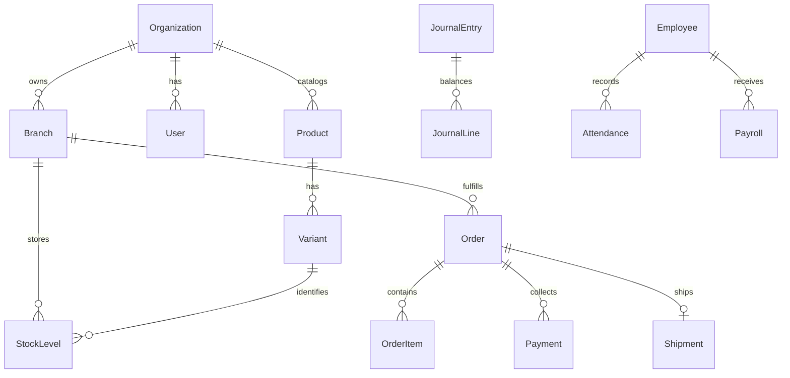

# Architecture

Panjabi Business is a Laravel 12 / Filament 5 modular monolith. The public site and storefront use Blade; Filament handles catalog/reference-data administration; dedicated business pages handle transactional operations.

## Boundaries

- `Organization`: one independent business; `Branch`: a physical/fulfillment location in that business.
- `User`: one organization, one primary role, and an optional branch. The platform role has no organization and cannot enter ordinary business administration.
- `BusinessModel`: fail-closed organization global scope plus branch restrictions for selected operational tables. Model saves validate business foreign keys. Organization ownership cannot be changed after creation.
- `TenantContext`: request-scoped context. Store middleware resolves the organization from the trusted slug lookup; ordinary staff requests resolve it from the authenticated user.
- Platform overview intentionally queries organization metadata and unscoped branch counts only. It does not impersonate tenant users.

## Main services

| Service | Responsibility |
| --- | --- |
| `Inventory` | Transactional conditional quantity changes and stock movement records |
| `Orders` | Checkout/POS orders, payments, state changes, cancellation, item returns |
| `Ledger` | Balanced journal entries with unique references |
| `Operations` | Partial purchasing, supplier payments, transfers, production, tailoring, payroll, expenses |
| `Modules` | Activation, declared dependencies, operation checks |
| `CatalogCsv` | File validation, preview, transactional unpublished catalog import |
| `AiCatalog` | Requested package pipeline, application-owned draft approval |
| `SafePageReader` | Public HTTPS source fetching with network restrictions |
| `Courier` | Explicitly simulated shipment/COD/remittance operations |
| `DemoGateway` | Explicitly simulated payment attempts and signed callbacks |
| `AttendanceImport` | Requested attendance package's fake device to normalized business events |
| `LocalPdfEngine` | Requested PDF package layout/writer with bundled fonts and no request-time font downloads |

## Money and inventory

All financial values use integer poisha. Whole-unit inventory quantities are used. Variants carry a standard cost that becomes immutable after movements. Purchases and production reconcile actual costs through variance accounts. This keeps stock valuation based on one explicit standard; moving average, FIFO, and revaluation are not implemented.

Orders deduct available stock when accepted, rather than maintaining a separate expiring reservation layer. Invoice accounting is also posted at acceptance. Cancellation restores stock and reverses the posting. This operational recognition policy needs review before statutory production accounting.

`Inventory::move` uses an atomic conditional update for negative quantities. Financial workflows wrap stock and ledger changes in database transactions. Payment references, order idempotency keys, and unique employee/month payroll keys provide additional duplicate protection. Further race/load testing is outstanding.

## Main relationships

## Explicit limits

This is not an audited SaaS isolation framework. It is a tested application foundation with the access boundaries listed above. Cross-business memberships, editable fine-grained permissions, complete event auditing, queue tenant-context helpers, fiscal controls, production outbox delivery, and external integration hardening remain on the roadmap. No background business jobs are dispatched by the current core flows.
